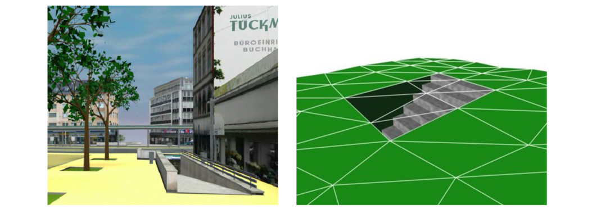
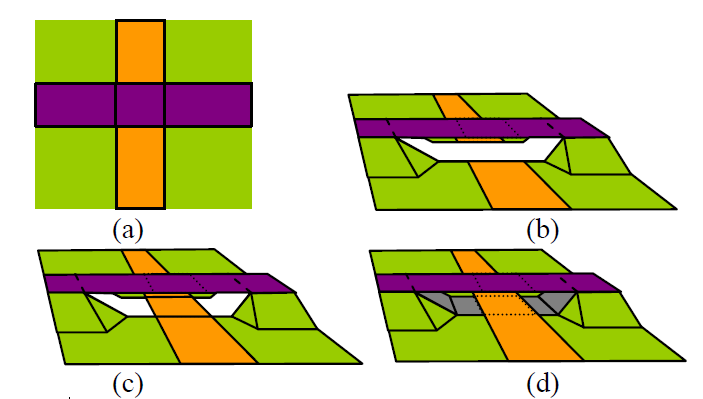

# Algemene principes

Voor de inhoud van de IMGeo-3D  zijn de volgende algemene principes gehanteerd.

## Bronhouders

Het bronhoudersprincipe blijft in 3D ongewijzigd t.o.v. BGT/IMGEO. 

## Manier van 3D inwinning

Er zijn verschillende methoden om 3D-gegevens voor IMGeo-3D in te winnen en te verwerken. Er zijn drie belangrijke routes om tot 3D-geoinformatie voor IMGeo-3D te komen. Dit zijn: 

- **Directe 3D inwinning:** 3D gegevens worden rechtstreeks in de werkelijkheid ingewonnen met bijvoorbeeld LiDAR, fotogrammetrie of landmeetkundige metingen. 
- **3D-verrijking van bestaande 2D registraties:** Bestaande 2D IMGeo-/BGT-gegevens worden aangevuld met hoogte- en andere 3D-informatie en vervolgens verwerkt tot 3D-geoinformatie.  
- **Van 3D-BIM naar 3D-Geo:** bestaande 3D BIM-modellen worden getransformeerd naar 3D-Geoinformatie. 

IMGeo-3D houdt rekening met verschillende methoden waarop 3D-gegevens kunnen worden ingewonnen en opgebouwd. De wijze waarop gegevens zijn ingewonnen, bepaalt welke informatie beschikbaar is en welke mogelijkheden en beperkingen dit met zich meebrengt voor de verdere verwerking en modellering.

## Talud

Kruinlijngeometrie vervalt in IMGeo-3D. 

## Functioneel gebied

In IMGeo-3D valt functioneel gebied onder het concept Virtuele ruimte. Dit sluit aan op CityGML3.0  die onderscheid maakt in Ruimte die kan worden geclassificeerd als Ingenomen Ruimte(OccupiedSpace) en Vrije Ruimte (UnoccupiedSpace) waarbij de ruimte met de properties class, functie en gebruik gespecificeerd kunnen worden.

## Coördinaat-referentiesysteem
Het toegepaste coördinaatsysteem voor IMGEO-3D is een samengesteld CRS voor Nederland met de naam RDNAP(EPSG:7415). Dit coördinaatsysteem is een samenstelling van het Geprojecteerd CRS Rijksdriehoeksmeting (RD-stelsel (EPSG:28992)), waarmee men de x en y coördinaten kan duiden, en het Vertikaal CRS Normaal Amsterdams Peil (NAP (EPSG:5709)).

De coördinaatgetallen zijn daarbij op millimeternauwkeurigheid met als eenheid meters. Het coördinaatgetal heeft maximaal drie cijfers achter de komma. <mark>(Waarom?!?! Onhandig met  vergelijkingen met omgevingen waar dit wel mag)</mark> Zo nodig wordt daarvoor afgerond,zodanig dat als het vierde cijfer achter de komma de waarde 1 t/m 4 bedraagt, het derde cijfer achter de komma niet wijzigt en als het vierde cijfer achter de komma de waarde 5 t/m 9 bedraagt, het derde cijfer achter de komma met één wordt
verhoogd, met mogelijk ook implicaties voor de voorliggende cijfers, waarbij dezelfde regel geldt.

Het RDNAP-stelsel voldoet aan de eisen van de Europese richtlijn INSPIRE. Deze
stelt dat binnen de Europese continentale aardschol, waartoe ook Nederland en
het Nederlandse deel van de Noordzee behoort, geldt dat coördinaten herleidbaar
moeten zijn tot het European Terrestrial Reference System 1989 (ETRS89) voor de
horizontale en verticale component. 

## Geometrietypen

Het BGT-informatiemodel beschrijft het geometrietype als een associatie van een
object met een geometrie-object. Daarbij maakt de BGT onderscheid in solid-, vlak-,
lijn- en puntgeometrie. Tot de BGT-inhoud behoren de volgende objecten.

Dit wordt in Imgeo-3D:

| *Object*                                                    | *BGT classificatie*            | *Plus classificatie*                       | *Geometrie*            |*Ruimte*          |*Verplicht/optioneel*      | 
|-------------------------------------------------------------|--------------------------------|--------------------------------------------|------------------------|------------------|---------------------------|
| *Bouwwerk*                                                  |                                |                                            |                        |                  |                          |
| **Pand**                                                    | Grondvlaksituatie van BAG-pand |                                            | LOD 0.1 3D TriangulatedSurface    | 3D    |               Verplicht           |
|                                                             | 3D blokmodel boven maaiveld van BAG-pand met 1 hoogte|                      | LOD 1.2 3D Solid met 2D grondvlak      | 3D             | Optioneel per set           |
|                                                             | 3D blokmodel boven maaiveld van BAG-pand met meerdere hoogte|               | LOD 1.3 3D Solid met 2D grondvlak      | 3D             | Optioneel per set           |
|                                                             | 3D blokmodel boven maaiveld van BAG-pand met meerdere hoogte|               | LOD 2.2 3D Solid       | 3D             |         Optioneel per set                   |
|                                                             | Gecombineerd 3D blokmodel per verdieping boven maaiveld van BAG-pand met meerdere hoogte |               | LOD C.1* 3D Solid       | 3D           | Optioneel per pand |
|                                                             | Gecombineerd 3D blokmodel per verdieping boven maaiveld van BAG-pand met meerdere hoogte |               | LOD D.2* 3D Solid of 3D Compound Geometry (Solid met 3D Multisurface)       | 3D           | Optioneel per pand |
       
<mark>Voor de beschrijving van geometrieën geldt het ISO 19107 Spatial Schema. Voor de uitwisseling wordt gebruik gemaakt van Geography Markup Language (GML) 3.1.1. </mark>

In de LOD 0.1-serie van IMGeo-3D zijn de geometrieën gerepresenteerd met een TINsurface (traingulatedSurface) per object. Het LOD0 terrein wordt gevormd door een verzameling aangrenzende driehoeken waarin de objectgrenzen herkenbaar zijn (constrained TIN). Als gevolg hiervan zijn alleen platte vlakken en rechte lijnen toegestaan en dusgeen gekromde oppervlakten of cirkelbogen.

In de LOD 1-, LOD 2- en LOD 3-serie van IMGeo-3D wordt voor volumetrische geometrieën GM_Solid gebruikt. De begrenzing van deze solids wordt opgebouwd uit oppervlakken die gebruikmaken van de geometrieën die binnen het GML 3.1.1 Simple Features Profile v1.0 zijn toegestaan, aangevuld met cirkelbogen (GM_Arc).

De geometrie-objecten worden in het informatiemodel met hun ISO 19107 naam, 
zoals GM_Surface, aangeduid. Bij objecten die een lijn- of een vlakgeometrie
kunnen hebben, is een associatie met GM_Object gelegd. Een GM_Object mag een ISO
punt, lijn, of volume zijn. In de praktijk betekent dit voor BGT objecten dat lijn-
of vlakgeometrie is toegestaan. Bij hetzelfde objecttype kan in het optionele
IMGeo-deel mogelijk wel puntgeometrie voorkomen.

| Geometrietype             | ISO aanduiding  |
|---------------------------|-----------------|
| Getrianguleerd oppervlak  | GM_TIN
| Vlak                      | GM_Surface      |
| Lijn                      | GM_Curve        |
| Punt                      | GM_Point        |
| Multivlak                 | GM_MultiSurface |
| Multipunt                 | GM_MultiPoint   |
| Solid                     | GM_Solid        | 
| MultiSolid                | GM_MultiSolid   |
| Geometrie algemeen        | GM_Object       |

Zowel lijn-, vlak- als solidvormige objecten kunnen bestaan uit een boogvorm. Voor de
representatie van boogvormen zijn er twee mogelijkheden in de BGT toegestaan,
namelijk benadering van de boog met:

-   lineaire lijnsegmenten, de zogenaamde gestrookte boog;

-   beschrijving van de boog met drie punten (GM_Arc).

Voor het weergeven van cirkels kan men gebruik maken van twee bogen. Gebruik van
GM_Circle is niet toegestaan.

## Topologie in 3D 

Alleen de grondvlaksituatie van objecten doet mee in de topologische structuur. 3D blokmodellen en objecten die virtuele ruimte zijn, doen, in tegenstelling tot alle objecten die Reeël object zijn én BGT-vlakobjecten, niet mee in de topologische structuur. Virtuele ruimte objecten liggen als een overlay over andere BGT-objecten. De begrenzing van virtuele ruimte hoeft niet samen te vallen met de begrenzing van reeële objecten.

De BGT 1.2 modelleert vlakken op maaiveld als opdelend. Dit principe wordt overgenomen in de 3D LOD0.1 representatie. Dat betekent dat alle opdelende objecten op maaiveldniveau samen een 2.5D topologische gesloten structuur moeten vormen. 

De vlakobjecten in de BGT op maaiveldniveau (niveau 0) partitioneren de ruimte.
Dat betekent dat:

-   elk van deze objecten topologisch gestructureerd moet zijn;

-   deze objecten naadloos op elkaar aan moeten sluiten, zodat er op
    maaiveldniveau geen gaten voorkomen;

-   deze objecten elkaar niet mogen overlappen.

Waar gaten op maaiveldniveau ontstaan, bijvoorbeeld bij tunnels, kan men een  ClosureSurface gebruiken. Op deze manier ontstaat een gesloten terreinmodel. Closure Surfaces worden niet opgenomen in IMGeo-3D op locaties waar footprint zijn opgenomen in het terrein. 

De LOD0.1 geometrieën van alle IMGeo vlakobjecten op hoogteniveau 0 te samen vormen een topologisch consistent geheel in 2.5D (geen gaten of overlap).

Op maaiveldniveau is het grondgebied van Nederland volledig gebiedsdekkend. Het
totaal oppervlak van de projectie van alle objecten op maaiveldniveau is gelijk aan het
dekkingsgebied (zie paragraaf 2.4).

Bij niveauverschillen kunnen objecten zich boven of onder elkaar bevinden. Objecten op een niveau anders dan het maaiveld doen niet mee in de topologische structuur. 

Elk objecttype op LOD 0.1 bevat één geometrie op één niveau. Dit betekent bijvoorbeeld dat een weg zich opsplitst in meerdere wegdelen met eigen identificaties als deze over een brug loopt, ook al zijn de rest van de kenmerken gelijk. In de LOD 1.2, 1.3 en 2.2 representatie en in de LODC.1 en LODD.2 geldt deze regel niet.  

Voor Solids in LOD 1.2, 1.3, 2.2, C.2 en D.2 geldt : 
- Elke Solid is geldig
- Solids mogen niet ongewenst overlappen.  

## Niveauaanduidingen per object 
Om in de 2D BGT om te kunnen gaan met objecten die boven en onder elkaar liggen is het attribuut relatieveHoogteligging geïntroduceerd. In de regel zal open, bovengronds water, niveau 0 hebben. Objecten op een bovenliggend niveau (bijvoorbeeld een overbrugging over water) krijgen een hoger niveaugetal toebedeeld. Objecten op een onderliggend niveau (bijvoorbeeld een tunnel) krijgen een lager niveaugetal.
Dit niveaugetal kan gebruikt worden om wegdelen of water- en wegdelen die elkaar ongelijkvloers kruisen in LOD0.1 te modelleren. 

Vlakobjecten boven en onder het maaiveld worden in LOD0.1 als volgt gemodelleerd. Vlakobjecten boven en onder het maaiveld worden met hun 2.5D LOD0.1 representatie (TriangulatedSurface) in de derde dimensie geplaatst, op hun werkelijke hoogte. Een belangrijke eis hierbij is de aansluiting op het 2.5D IMGeo-surface dat het maaiveld representeert (niveau 0) voor onder- en bovengrondse objecten die ergens het maaiveld raken. Voor deze aansluiting kan het nodig zijn om nieuwe 2D grenzen toe te voegen welke een extra variatie in 3D kunnen beschrijven zoals te zien in onderstaande figuur (B). Daarnaast kan het nodig zijn om terreinvlakken onder of boven deze objecten aan te brengen daar waar in 2D geen expliciete stapeling van objecten is gemodelleerd om ervoor te zorgen dat de LOD0 representatie op maaiveld geen gaten bevat; zie onderstaande figuur (c en d). Dit kunnen ook closure surfaces zijn. 

**Volledigheid van IMGeo vlakken in LOD0.1**  
De Gegevenscatalogus BGT geeft aan dat in de regel open, bovengronds water niveau 0 zal hebben. Als gevolg zullen bruggen over water op niveau > 0 liggen en geen deel uitmaken van de LOD0.1 representatie. Vanuit traditionele cartografische weergaven van dergelijke situaties is een gebruiker vaak gewend om een bovenaanzicht te zien, waarbij dus de brug zichtbaar is en niet het waterdeel, waardoor het wegenpatroon herkenbaar blijft. Een correcte en volledige LOD0.1 IMGeo representatie is alleen mogelijk indien alle vlakobjecten, ongeacht hoogteniveau, worden toegevoegd. Dit is belangrijk om te realiseren, omdat het in tegenspraak is met de gangbare opvatting dat een LOD0.1 representatie slechts een basale 'drape' is van een 2D bestand over een hoogtebestand. Dergelijke 'drapes' van 2D bestanden (topografisch of luchtfotografie), zoals dat ten tijde van de introductie van het AHN-1 veel gebeurde, draperen op elke locatie het hoogst gelegen object (bovenaanzicht) op het hoogtemodel en resulteren dus niet in IMGeo conforme LOD0 representaties op het maaiveld (hoogteniveau=0).

## Hiërarchie in objecten en domeinwaarden
<mark>
BGT-objecten bezitten attributen die kenmerken van het object beschrijven. Welke
waarde(n) de attributen kunnen of mogen hebben is vastgelegd in domeinwaarden.

Voor drie zaken is het van belang om hiërarchie te hanteren bij BGT-objecten,
domeinen en domeinwaarden, te weten:

-   afbakenen van objecten;

-   toekennen van domeinwaarden;

-   visualiseren.

Voor de eerste twee punten geldt dat het object met de beste idealisatiewaarde
(zie paragraaf 4.2) voorrang heeft boven een object met een minder goede waarde.
Als objecten dezelfde idealisatiewaarde hebben, dan geldt de volgorde van de
beschrijving van de objecten in hoofdstuk 8 en de volgorde van de domeinwaarden
in hoofdstuk 9. Een eerder beschreven object of domeinwaarde heeft dan voorrang
boven het daarna vermelde object of domein­waar­de.

Voor het derde punt, de visualisatie van de BGT, gelden afwijkende regels. Deze
regels zijn opgenomen in hoofdstuk 5 van het document Visualisatieregels BGT en
IMGeo.
</.mark>

<mark>
De BGT stelt eisen aan de positionele nauwkeurigheid, waarmee een object wordt ingewonnen en vastgelegd. Onder positionele nauwkeurigheid verstaat men de mate waarin de opgeslagen coördinaten overeenkomen met de waarden in de werkelijkheid of de geaccepteerde afwijking. De positionele nauwkeurigheid in de BGT is de combinatie van precisie en betrouwbaarheid, ook wel geometrische nauwkeurigheid genoemd.

De positionele nauwkeurigheid van een object wordt beschreven op het niveau van het objecttype. Hiermee wordt aan elk object binnen dat objecttype een nauwkeurigheidseis gesteld. De BGT hanteert voor het beschrijven van de positionele nauwkeurigheid de relatieve precisie. Een uitgebreide theoretische beschrijving hiervan staat in het Handboek Technische Werkzaamheden van het Kadaster uit 1996 (HTW 1996). Bij de precisiebeschrijving wordt onderscheid gemaakt tussen de relatieve precisie van coördinaten ten gevolge van de ontstaanswijze (het meet-en verwerkingsproces) en de idealisatie. Toepassing van het meet- en verwerkingsproces levert de vereiste minimumwaarde op. Relatieve precisie geldt alleen voor nabijgelegen punten.

Hieronder staan de waarden voor de minimale toegestane kwaliteit voor de positionele nauwkeurigheid van 30 en 60 cm. Het zijn afrondingen van de in de HTW 1996 vermelde waarden voor de lengte van de halve lange as van de relatieve standaardellips tussen twee punten in.

Objecten met een hoge positionele nauwkeurigheid: 20 cm x √2 = 28,3 cm, afgerond: 30 cm;

Objecten met een lage positionele nauwkeurigheid: 40 cm x √2 = 56,6 cm, afgerond: 60 cm.

De punten in het veld dienen te zijn ingemeten en in het bestand te zijn verwerkt volgens de regels, zoals beschreven in de HTW van 1996, inclusief het supplement voor detailmeten met GPS.

De tabel hieronder vermeldt de minimale waarden van de toegestane kwaliteit voor de positionele nauw­keu­rig­heid per objecttype. In de laatste kolom staan de waarden voor idealisatie per objecttype. Een bronhouder is volledig vrij om voor zijn eigen objecten hogere nauwkeurigheidseisen te hanteren dan voor de BGT zijn vereist.

Omdat de BGT bestaat uit een verzameling objecten wordt in de tabel per object een generieke waarde voor de maximaal toegestane afwijking vermeld tussen nabijgelegen punten met dezelfde idealisatiewaarden en van hetzelfde object.

DIT MOET ER UIT
</mark>