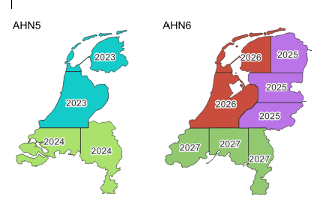

# Datakwaliteit

Alle datakwaliteitsissues blijven bestaan. Geen wijziging. 

## Actualiteit 

Actualiteit als concept komt overeen met de 2D situatie. 

### Relatie actualiteit en bijhoudingsfrequentie
Om een vastgestelde actualiteit van een bestand als IMGEO-3D te kunnen garanderen
moet de inwinning en het verwerkingsproces daarvan met een hogere frequentie
plaatsvinden. 

Dit geeft een uitdaging met automatisch gegenereerde 3D geometrie. Wanneer 3D-geometrie wordt gemaakt door de BGT-grondvlakken en BAG-dakomtrek hoogte te geven van de AHN, dan geldt de actualiteit van de 2D meetgegevens én de hoogtegegevens. Een 3D-object is zo actueel als de oudste van de twee bronnen. De AHN wordt in een cycli van meerdere jaren ingevlogen. Het is daarmee niet mogelijk om een Pand-geometrie in 3D, wanneer automatisch gegenereerd op basis van AHN, een actualiteit te geven binnen de norm.  

Bij een nieuwe asset (pand, brug, etc.) ontbreekt de hoogte zolang er na de bouw nog niet opnieuw gevlogen is.

Er zijn andere hoogtebronnen die wel vaker worden ingewonnen. Uit de jaarlijkse stereoluchtfoto's (Beeldmateriaal Nederland) kun je met dense image matching een puntenwolk afleiden, en sommige bronhouders laten zelf lidar vliegen. 
<mark> Wat hier te eisen? Dense image matching geeft mindere kwaliteit maar kan op basis van stereoluchtfoto's gemaakt worden. Dit geeft een jaarlijkse actualiteit. </mark>

### Positionele nauwkeurigheid

Ook voor 3D objecten geldt een geometrische nauwkeurigheid. 

<mark>
Bij de precisiebeschrijving wordt onderscheid gemaakt tussen de relatieve precisie van coördinaten ten gevolge van de ontstaanswijze (het meet-en verwerkingsproces) en de idealisatie. Toepassing van het meet- en verwerkingsproces levert de vereiste minimumwaarde op. Relatieve precisie geldt alleen voor nabijgelegen punten.

Hieronder staan de waarden voor de minimale toegestane kwaliteit voor de
positionele nauwkeurigheid van 30 en 60 cm. Het zijn afrondingen van de in de
HTW 1996 vermelde waarden voor de lengte van de halve lange as van de relatieve
standaardellips tussen twee punten in.

-   Objecten met een hoge positionele nauwkeurigheid: 20 cm x √2 = 28,3 cm,
    afgerond: 30 cm;

-   Objecten met een lage positionele nauwkeurigheid: 40 cm x √2 = 56,6 cm,
    afgerond: 60 cm.

De punten in het veld dienen te zijn ingemeten en in het bestand te zijn
verwerkt volgens de regels, zoals beschreven in de HTW van 1996, inclusief het
supplement voor detailmeten met GPS.

De tabel hieronder vermeldt de minimale waarden van de toegestane kwaliteit voor
de positionele nauw­keu­rig­heid per objecttype. In de laatste kolom staan de
waarden voor idealisatie per objecttype. Een bronhouder is volledig vrij om voor
zijn eigen objecten hogere nauwkeurigheidseisen te hanteren dan voor de BGT zijn
vereist.

Omdat de BGT bestaat uit een verzameling objecten wordt in de tabel per object
een generieke waarde voor de maximaal toegestane afwijking vermeld tussen
nabijgelegen punten met dezelfde idealisatiewaarden en van hetzelfde object. </mark>

<mark> Staat dit ook in het handboek technische werkzaamheden van het kadaster uit 1996?</mark>

De BGT hanteert voor het beschrijven van de
positionele nauwkeurigheid de relatieve precisie. 

| BGT-object              | Type           | Actualiteit van object in maanden | Positionele nauwkeurigheid tussen punten van object in cm | Idealisatie per punt van object in cm |
|-------------------------|----------------|-----------------------------------|-----------------------------------------------------------|---------------------------------------|
| Pand                    |                | 6                                 | 30                                                        | 0 – 2                                 |
| Pand 3D?                |                | 18?                                | ?                                                         | ?                                     |

Tabel 1 Per objecttype generieke waarden voor actualiteit, positionele nauwkeurigheid en idealisatie

