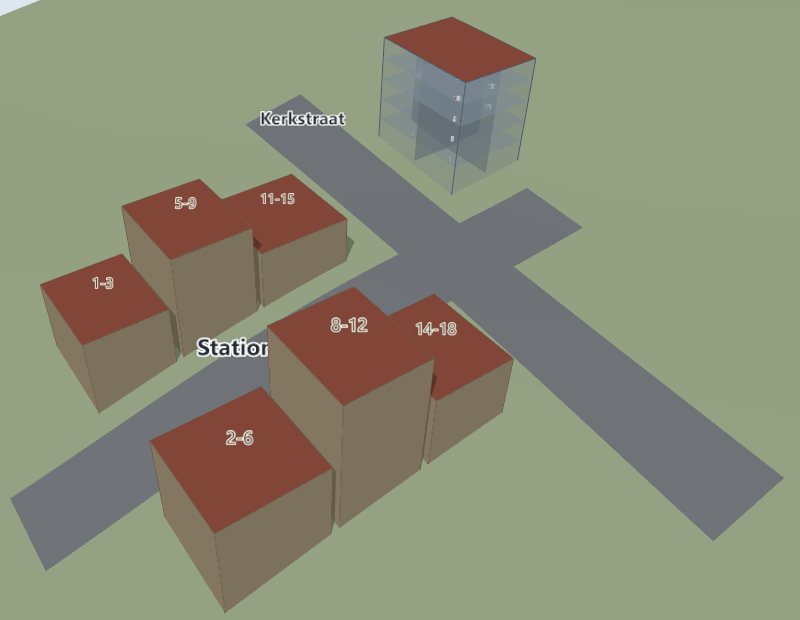
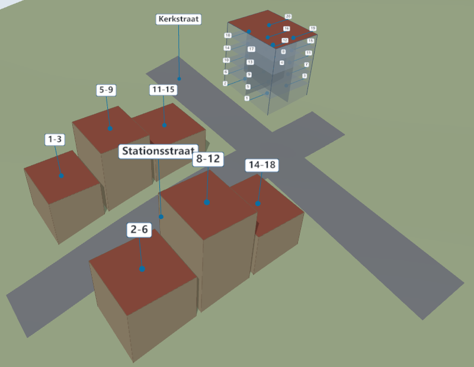
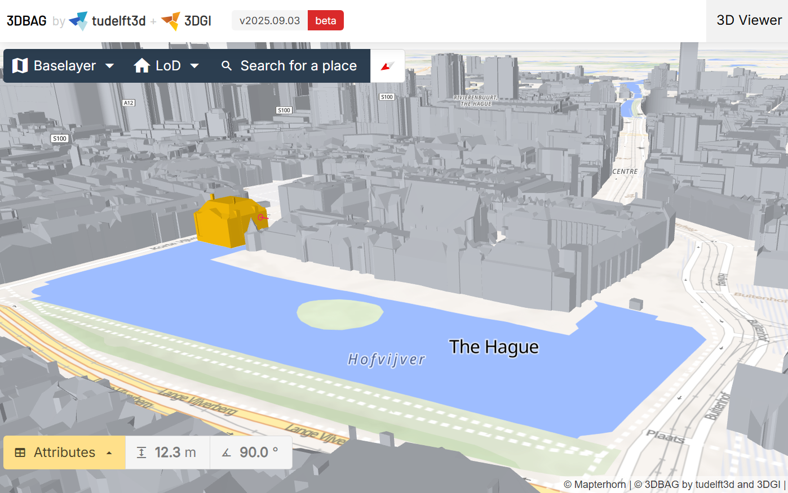

# Teksten 

De visualisatie van de 2D BGT|IMGeo is beschreven in het document [Visualisatieregels BGT en IMGeo](https://docs.geostandaarden.nl/bgt/visualisatie/). Voor 3D dient de handreiking uitgebreid te worden of dient er een aparte Visualisatieregel 3D BGT en IMGeo te komen. 

Alleen over de visualisatie van teksten wordt in deze gegevenscatalogus iets gezegd. Dit is nodig, omdat deze zaken al door de bronhouders in acht moeten worden genomen, om uiteindelijk een kaartbeeld van de BGT landelijk op een uniforme wijze te kunnen presenteren.

In de BGT worden teksten opgenomen voor visualisatie en oriëntatie. In de 2D BGT|IMGeo worden teksten die zijn opgenomen vergezeld van een geometriepunt en eventuele rotatie. Deze teksten betreffen namen van openbare ruimten en een nummeraanduidingreeks bij panden. In 3D kan dit ook nodig zijn. Maar er zijn alternatieven. 

Er zijn meerdere manieren om teksten in 3D te tonen:

- **Platte tekst**: de tekst ligt in een vlak, bijvoorbeeld op het wegdek, op het dak of op de gevel. Het punt en de rotatie uit de BGT blijven hun betekenis houden. Nadeel hiervan is dat van bovenaf de tekst goed leesbaar is, maar bij een schuine of lage kijkhoek wordt hij vervormd of staat hij op zijn kop. Het punt van de nummeraanduidingreeks, dat in 2D op maaiveld binnen een object (bijvoorbeeld pand) ligt, dient in 3D naar de bovenkant van dit object (bijvoorbeeld dak) te worden getild. Anders valt de tekst binnen het object en is hij niet zichtbaar.
- **Billboard**: de tekst staat rechtop en draait altijd naar de kijker toe. De tekst is vanuit elke hoek leesbaar. De rotatie uit de BGT heeft geen betekenis meer. Nadeel hiervan is dat de tekst kan worden afgedekt door panden.
- **Callout line**: het label zweeft op enige afstand van het object en een lijn wijst naar het punt waar de tekst bij hoort. Het label is altijd zichtbaar en eenduidig aan het object gekoppeld, maar bij veel labels wordt het beeld snel druk.

Per weergave verschilt welke gegevens nodig zijn. Alleen bij platte tekst is de rotatie nodig; bij billboard en callout line draait de tekst altijd naar de kijker.

| Weergave     | Punt (x, y, z) | Rotatie | Overig                                   |
|--------------|----------------|---------|------------------------------------------|
| Platte tekst | ja             | ja      | helling, of draperen over het maaiveld   |
| Billboard    | ja             | nee     |                                          |
| Callout line | ja             | nee     | eventueel de verschuiving van het label  |

### Appartementen: huisnummer per woning

Bij een appartementencomplex horen meerdere huisnummers bij één pand, verdeeld over meerdere woonlagen. In 2D worden deze huisnummers samengevat in één nummeraanduidingreeks. In 3D kan elk huisnummer een eigen punt krijgen op de vloerhoogte van de woonlaag van het betreffende appartement (verblijfsobject). Woningen liggen daarbij niet alleen boven elkaar, maar ook naast elkaar aan de voorkant (straatkant) en aan de achterkant van het gebouw. 

### Voorbeeld

Het onderstaande voorbeeld toont de drie weergaven in een fictieve situatie op een hellend terrein, met twee straten, een aantal panden en een appartementencomplex. Met de knoppen kies je de weergave en de camerastand (overzicht, voorzijde of achterzijde van het complex). Met de muis kun je het beeld draaien, zoomen en verschuiven. Het voorbeeld is ook [los te openen](media/teksten3d/teksten-3d-voorbeeld.html).

<iframe src="media/teksten3d/teksten-3d-voorbeeld.html" title="Interactief voorbeeld van teksten in 3D" width="100%" height="520" style="border:1px solid #c9d1da; border-radius:4px;" loading="lazy"></iframe>

Voor wie het interactieve voorbeeld niet kan bekijken, staan hieronder schermafbeeldingen van de drie weergaven.

<figure id="fig-teksten-3d">
  

    
    
    
  

  <figcaption>Teksten in 3D: platte tekst (links), billboard (midden) en callout line (rechts)</figcaption>
</figure>

De 3DBAG viewer maakt gebruik van billboards
 

Rotatie en verschuiving
-------

Wanneer een platte tekst als visualisatie van tekst wordt gekozen kan de voor 2D gespecificeerde rotatie ook gebruikt worden voor de 3D visualisatie. Wanneer een callout line gekozen wordt dient men óf een twee labelpunt te definieren wanneer men zelf grip wil hebben op de plaatsing van de callout line. Of dit moet door een viewer worden opgelost. Dit kan zorgen voor verschil in positionering. 