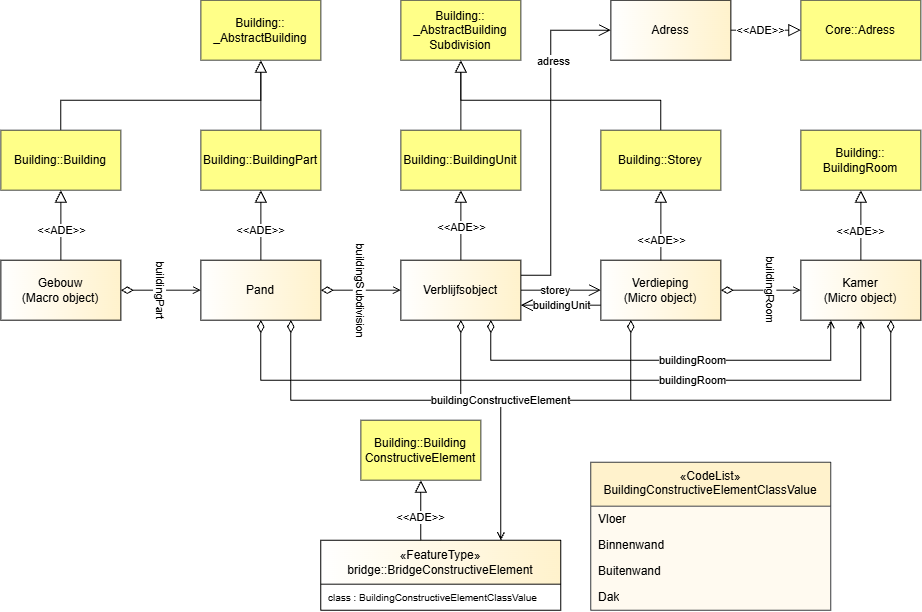
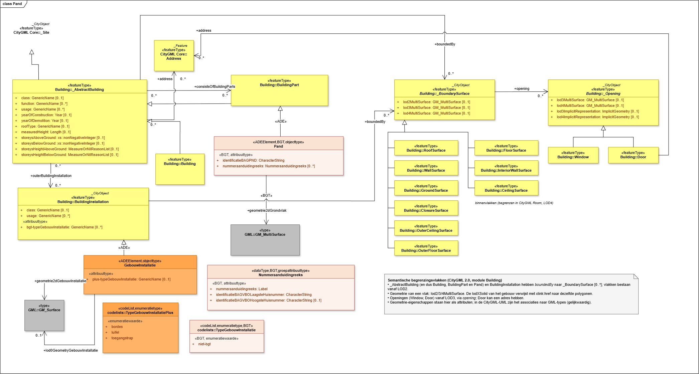

Semantisch gegevensmodel
========================

Het IMGeo gegevensmodel is te uitgebreid om in één plaat te laten zien.
Hieronder wordt het overzicht getoond in twee delen waarop de objecttypen, die
tot de BGT behoren, in lichtroze zijn afgebeeld en de objecttypen, die tot het
optionele IMGeo deel behoren, in oranje.

In het model is te zien dat de IMGeo klassen zijn afgeleid van klassen van
CityGML. De klasse IMGeo-Object is gedefinieerd als een «ADEElement»
specialisatie die extra eigenschappen toevoegt aan \_CityObject uit CityGML. Via
die klasse erven alle IMGEO objecttypen deze eigenschappen

Alleen voor Pand: 

In 3D komen de afzonderlijke vlakken overeen met de werkelijke onderdelen van het object: een vlak is de gevel, het dak of de grondvlakte. Daardoor kan semantiek in 3D belangrijker zijn dan in 2D. Wanneer bekend is wat elk vlak voorstelt, kan men de geometrie gebruiken voor toepassingen zoals het berekenen van dak- of geveloppervlak.

De semantiek van een Pand kan op twee niveaus worden vastgelegd. Bij semantische begrenzingsvlakken (semantic surfaces) krijgt elk vlak van de geometrie een betekenis, zoals dakvlak, gevel of grondvlak. Bij semantische decompositie wordt het Pand opgedeeld in onderdelen met elk een eigen geometrie en eigen kenmerken, zoals hoofdvolume, aanbouw of dakkapel. De twee benaderingen sluiten elkaar niet uit: in CityGML kan een gebouwdeel zelf weer begrenzingsvlakken hebben.

Voor de uitwisseling via JSON-FG heeft semantische decompositie de voorkeur. JSON-FG kent per feature één geometrie en geen semantiek per vlak. 

In de 3DBAG worden de volgende semantic surfaces onderscheiden:  
- 0: GroundSurface 
- 1: RoofSurface 
- 2: OuterWallSurface 
- 3: InnerWallSurface
 

Semantische decompositie of het gebruik van semantic surfaces zorgt er bijvoorbeeld voor dat men de daken rood kan kleuren en de gevels grijs. 